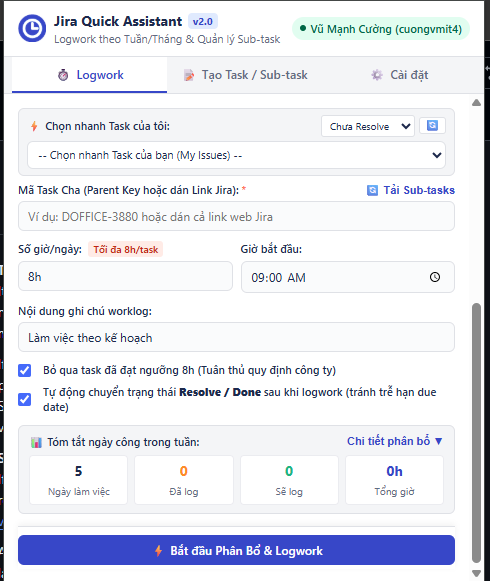
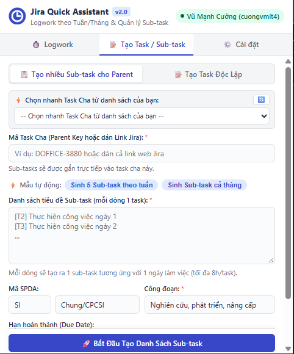

# 🚀 Jira Quick Assistant v2.0 - Tự Động Hóa Task & Logwork Jira VNPT

Tiện ích mở rộng (**Chrome Extension Manifest V3**) được tối ưu riêng cho quy trình doanh nghiệp (VNPT / CNTT) trên hệ thống **Jira Server / Data Center** (`https://cntt.vnpt.vn`):

- **Chọn nhanh dữ liệu có sẵn (Quick Select)**: Tự động nạp danh sách **Dự án (Projects)** và **Task đang mở của tôi (My Open Issues)** qua JQL (lọc theo Chưa Resolve, Chưa Logwork, Gần đây) kèm tính năng tự động điền (Auto-fill).
- **Logwork theo Tuần & Tháng linh hoạt**: Mặc định tự động chọn tuần làm việc hiện tại, hỗ trợ kiểm soát chặt chẽ ngày lễ/nghỉ.
- **Tạo hàng loạt Sub-task cho Parent Issue**: Tự động sinh mẫu 5 Sub-task theo từng ngày trong tuần gắn trực tiếp vào task cha (hỗ trợ đầy đủ Due Date, Assignee, Mã SPDA và Công đoạn).
- **Phân bổ nhiều Task & Tuân thủ quy định tối đa 8h/task**: Ghép cặp 1-1 (1 ngày làm việc = 1 sub-task = tối đa 8 giờ), tự động kiểm tra và bỏ qua task đã đạt ngưỡng 8h để tránh vi phạm quy định công ty.
- **Tự động Resolve Task sau khi logwork**: Tùy chọn tự động chuyển trạng thái hoàn thành task ngay sau khi ghi giờ để tránh quên và không bị trễ due date.
- **Giao diện Atlassian UI tinh gọn**: Nút hành động chính luôn ghim cố định ở đáy (Sticky button), loại bỏ thanh cuộn kép.
- **Tự động nhận diện URL**: Dán nguyên link web Jira (ví dụ: `https://cntt.vnpt.vn/browse/DOFFICE-3880`), hệ thống tự động bóc tách Domain gốc và mã Issue Key.

---

## 📸 Giao diện trực quan (Screenshots)

<p align="center">
  
  &nbsp;
  
</p>

---

## 📂 Cấu trúc dự án
```
jira-quick-assistant/
├── manifest.json            # File cấu hình Chrome Extension Manifest V3
├── popup/
│   ├── popup.html          # Giao diện Popup 3 Tab nâng cấp v2.0 (Sticky footer, Quick Select)
│   ├── popup.css           # Định dạng CSS Atlassian UI, thanh cuộn đơn, ghim nút cố định
│   └── popup.js            # Điều phối chia tuần, tải sub-tasks, auto-fill và kiểm soát 8h/task
├── scripts/
│   ├── jira-api.js         # Giao tiếp Jira REST API (JQL search, sub-tasks, worklog, XSRF token)
│   └── date-utils.js       # Phân chia tuần làm việc, bóc tách URL, tính ngày công
├── assets/
│   ├── icons/              # Bộ icon 16x16, 48x48, 128x128
│   └── screenshots/        # Ảnh chụp màn hình giao diện thực tế
├── .gitignore              # Cấu hình bỏ qua file rác IDE và OS
├── RELEASE_NOTES.md        # Lịch sử cập nhật và tính năng qua các phiên bản
└── README.md               # Tài liệu hướng dẫn sử dụng chi tiết
```

---

## 🛠️ Hướng dẫn cài đặt vào Google Chrome

1. Mở trình duyệt Google Chrome và truy cập: `chrome://extensions/`
2. Bật công tắc **Chế độ dành cho nhà phát triển** (**Developer mode**) ở góc trên bên phải.
3. Bấm nút **Tải tiện ích đã giải nén** (**Load unpacked**) ở góc trên bên trái.
4. Chọn thư mục dự án:
   ```
   D:\www\jira-quick-assistant
   ```
5. *(Mỗi khi có cập nhật code mới, chỉ cần bấm vào biểu tượng **Nạp lại (Reload / 🔄)** trên thẻ của tiện ích).*

---

## 📖 Hướng dẫn sử dụng các tính năng chính

### 1. Phân bổ & Logwork theo Tuần / Tháng (Tab "Logwork")
1. Mở tab **⏱️ Logwork**.
2. Tiện ích tự động chọn sẵn **Tuần làm việc hiện tại** của tháng.
3. Chọn Task để logwork:
   - **Cách 1 (Nhanh nhất)**: Sử dụng dropdown **⚡ Chọn nhanh Task của tôi** để chọn từ các task chưa hoàn thành được gán cho bạn.
   - **Cách 2**: Nhập mã Task cha hoặc dán cả link Jira vào ô input (ví dụ: `https://cntt.vnpt.vn/browse/DOFFICE-3880`).
4. Bấm **🔄 Tải Sub-tasks**: Hệ thống tự động kiểm tra số giờ đã log của từng sub-task và ghép cặp 1-1 cho từng ngày trong tuần. Task nào đã đủ 8h sẽ tự động được đánh dấu bỏ qua.
5. *(Khuyên dùng)* Tích chọn **Tự động chuyển trạng thái Resolve / Done sau khi logwork** để đóng task ngay khi log xong.
6. Bấm nút **⚡ Bắt đầu Phân Bổ & Logwork** (được ghim cố định ở đáy) để thực hiện ghi giờ tự động.

---

### 2. Tạo hàng loạt Sub-task cho Task Cha (Tab "Tạo Task / Sub-task")
1. Mở tab **📝 Tạo Task / Sub-task**.
2. Chọn Task Cha từ dropdown **⚡ Chọn nhanh Task Cha** hoặc dán link task cha vào ô input.
3. Bấm nút **⚡ Sinh 5 Sub-task theo tuần**: Hệ thống tự động điền danh sách 5 sub-tasks tương ứng từ Thứ 2 đến Thứ 6.
4. Các trường nghiệp vụ Jira VNPT được cấu hình tự động:
   - **Mã SPDA**: Mặc định `SI` - `Chung/CPCSI` (tự động nhận diện từ task cha).
   - **Công đoạn**: Mặc định `Nghiên cứu, phát triển, nâng cấp`.
   - **Due Date**: Tự động theo từng ngày làm việc (Thứ 2 hạn Thứ 2, Thứ 3 hạn Thứ 3...).
   - **Assignee**: Mặc định gán cho chính bạn.
5. Bấm **🚀 Bắt Đầu Tạo Danh Sách Sub-task**: Tiện ích tự động truy vấn Issue Type ID chính xác và khởi tạo tuần tự các sub-task trên Jira.
6. Bấm nút chuyển hướng nhanh sang tab Logwork để phân bổ ngay.

---

### 3. Cấu hình & Kết nối (Tab "Cài đặt")
- **Jira Base URL**: Mặc định sẵn là `https://cntt.vnpt.vn`.
- **Phương thức xác thực**:
  - **Session Cookie** (Mặc định): Tự động sử dụng phiên đăng nhập Jira hiện có trên trình duyệt (hoặc qua VPN VNPT).
  - **Personal Access Token (PAT)**: Hỗ trợ nhập token cá nhân nếu Jira yêu cầu.
- Bấm **🔌 Kiểm Tra Kết Nối (Ping)** để xác nhận trạng thái tài khoản.

---

## 🔗 GitHub Repository
- **Mã nguồn**: [https://github.com/cuongvu5111/jira-quick-assistant](https://github.com/cuongvu5111/jira-quick-assistant)
- **Tác giả**: Vũ Mạnh Cường (`cuongvmit4`)
